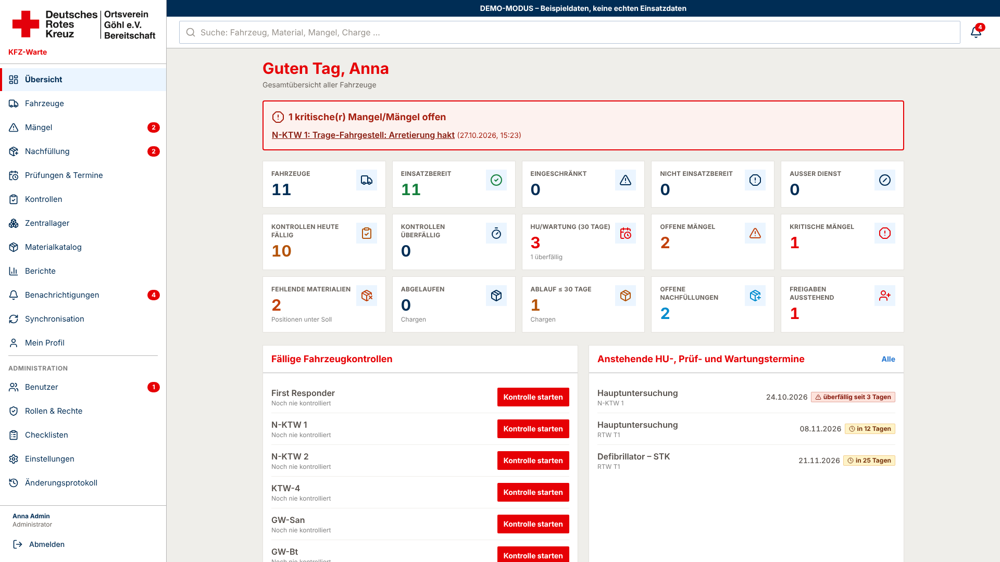

# KFZ-Warte – DRK Göhl

Web-App (installierbar als PWA) zur Verwaltung von Einsatzfahrzeugen, Fahrzeugkontrollen, HU-/Prüf- und Wartungsterminen, Fahrzeugmaterial mit Chargen und Verfallsdaten, zentralem Lager, Nachfülllisten und Mängeln.

| Thema | Dokument |
|---|---|
| Architektur, Datenmodell, Datenflüsse, Designentscheidungen | [docs/ARCHITEKTUR.md](docs/ARCHITEKTUR.md) |
| Benutzerrollen und Berechtigungen | [docs/ROLLEN.md](docs/ROLLEN.md) |
| **Installation auf eigenem Root-Server (Schritt für Schritt)** | [docs/INSTALLATION-ROOTSERVER.md](docs/INSTALLATION-ROOTSERVER.md) |
| Installation, Deployment, Cron, PWA (Android/iOS) | [docs/DEPLOYMENT.md](docs/DEPLOYMENT.md) |
| Datenbank-Backup & Wiederherstellung, Löschkonzept | [docs/BACKUP.md](docs/BACKUP.md) |
| Abnahmetests und Teststatus | [docs/TESTS.md](docs/TESTS.md) |
| Gestaltung nach DRK-Styleguide | [docs/DESIGN.md](docs/DESIGN.md) |

## Screenshots

Bildschirmfotos im PC-Format (1920×1080, Demo-Daten) liegen in [docs/screenshots](docs/screenshots).



## Technik

Next.js 15 (App Router, Server Components, Server Actions) · TypeScript · Tailwind CSS · PostgreSQL 16 · Prisma 6 · eigene serverseitige Sitzungen (bcrypt, httpOnly-Cookie) · Zod-Validierung · pdf-lib (PDF-Export) · Service Worker + IndexedDB (Offline-Entwürfe) · Vitest (Integrationstests gegen echte PostgreSQL-DB).

## Schnellstart (Entwicklung)

```bash
cp .env.example .env              # DATABASE_URL, SEED_ADMIN_* und CRON_SECRET anpassen
npm install
npx prisma migrate deploy         # Schema + Integritätsregeln (Trigger, CHECKs, partielle Indizes)
npm run db:seed                   # Rollen, Rechte, Stammdaten, Erst-Administrator
npm run db:fahrzeuge              # Fahrzeugbestand DRK OV Göhl anlegen (mehrfach ausführbar, überschreibt nichts)
npm run db:materialkatalog        # Standard-Materialkatalog (293 Artikel) anlegen (mehrfach ausführbar)
npm run db:materialkatalog:entfernen -- --ausfuehren   # Katalog wieder entfernen (ohne --ausfuehren nur Anzeige)
npm run dev                       # http://localhost:3000
```

Tests (benötigen eine **separate** Datenbank, deren Name `test` enthält, Standard `drk_kfz_test`):

```bash
TEST_DATABASE_URL="postgresql://drk:…@localhost:5432/drk_kfz_test" npm test
```

### Demo-Modus (optional)

Nur in einer **eigenen** Datenbank. Der Demo-Seed verweigert den Start, wenn bereits Produktivfahrzeuge existieren, und blendet in der Oberfläche einen gelben Hinweis „DEMO-MODUS“ ein.

```bash
DATABASE_URL=…/drk_kfz_demo npx prisma migrate deploy
DATABASE_URL=…/drk_kfz_demo npm run db:seed
DATABASE_URL=…/drk_kfz_demo DEMO_MODE=true npm run db:demo
# Anmeldung: demo.admin / demo.kfzwart / demo.helfer / demo.lager – Passwort „Demo-Passwort1“
```

## Fahrzeugbestand DRK OV Göhl

`prisma/fleet-goehl.ts` enthält die 11 Fahrzeuge/Einsatzmittel des Ortsvereins (8 Fahrzeuge mit Funkrufnamen „Rotkreuz Ostholstein 42/…“, Feldkochherd, Verpflegungs- und Logistikanhänger). Kennzeichen, Klassifizierung und Hersteller stammen von bos-fahrzeuge.info (Stand 27.10.2026); die Detailseiten (Modell, Baujahr, Aufbau) sind dort durch eine Bot-Prüfung geschützt und wurden nicht übernommen.

**Noch nachzutragen:** Kennzeichen/Hersteller RTW T1 (42/83-01, dort nicht gelistet), Kennzeichen Feldkochherd und beide Anhänger, für alle Modell, Baujahr, Erstzulassung, Kilometerstand. Auf bos-fahrzeuge.info sind ein „Betreuungs- und Verpflegungs-AnH“ (OH-RK 4001) und ein „Material-Anhänger“ (Böckmann, KI-AW 22) als außer Dienst geführt – ggf. identisch mit den aktuellen Anhängern.

## Materialkatalog und Materialprüfung

`prisma/material-catalog.ts` enthält 293 Katalogartikel in 14 Kategorien (Verband, Zugang, Atemweg, Diagnostik, Trauma, Hygiene, Geräte, Fahrzeug …) – **ohne Mengen**; Fach und Soll-Menge legt die KFZ-Warte je Fahrzeug fest. Jede Größe ist ein eigener Artikel (z. B. Venenverweilkanülen 14–24 G).

- **Medikamente** abgeglichen mit den *Handlungsempfehlungen für den Rettungsdienst in Schleswig-Holstein*, Version 10.0 (15.07.2025), Medikamentenappendix. Sichtbar erst nach Freischalten der Medikamentenverwaltung (Einstellungen).
- **Betäubungsmittel:** Kennzeichen „BtM“ am Material (Standard: Morphin, wie in den HE gekennzeichnet; weitere legt der Träger/ÄLRD fest). BtM sind nur mit dem Recht `materials.btm` sichtbar und buchbar, die Chargennummer ist Pflicht. Die App ergänzt das BtM-Buch nach BtMVV, ersetzt es aber nicht.
- **Verfallsdatum statt Charge:** Bestand wird je Verfallsdatum geführt; die Chargennummer ist optional (außer BtM).
- **Materialprüfung bei jeder Kontrolle:** Die gesamte Beladung wird Fach für Fach angezeigt (Soll, gebuchte Menge, Verfallsdaten). Je Position „Stimmt“, „Abweichung“ (tatsächliche Menge je Verfallsdatum, abgelaufene Stücke „entnommen“, weitere Stücke mit Verfallsdatum erfassen) oder bei Geräten „Defekt“. Abweichungen werden als Korrektur bzw. „abgelaufen“ gebucht, Fehlmengen kommen automatisch auf die Nachfüllliste, Defekte werden als Mangel gemeldet. Das Ergebnis ist Teil der revisionssicheren Kontrolle.

## Getroffene Standardentscheidungen

- **Logo & Design:** Gestaltung nach dem DRK-Styleguide (styleguide.drk.de): Wort-Bild-Marke des Ortsvereins (`public/brand/drk-goehl-logo.png`) ausschließlich auf weißem Grund, digital mind. 60 px hoch mit Schutzzone; Web-Farbpalette (DRK-Rot, Dunkelrot, Dunkelblau, Mittel-/Volltonblau, Hellblau, Dunkel-/Mittel-/Hellgrau); Hausschrift Helvetica Neue mit Ersatzschriften Open Sans → Arial. App-Icon und Favicon zeigen das runde Abzeichen der Bereitschaft Göhl auf Weiß (`public/brand/bereitschaft-goehl-logo.png`). Die Logovorlage ist nur 430×93 px; eine hochauflösende Datei/SVG sollte nachgereicht werden.
- **Zugriff ohne Fahrzeugzuweisung = nichts sichtbar** (außer Administratoren mit „Alle Fahrzeuge sehen“).
- **Fahrzeugkontrolle 1 × pro Kalendermonat** (Vorgabe OV Göhl, Standard für alle Fahrzeuge): fällig bis Monatsende, Erinnerung 7 Tage vor Monatsende, danach „überfällig“. Je Fahrzeug auf Tages- oder Mehrmonatsintervall umstellbar.
- **Fahrzeugfreigabe nie automatisch:** Das Schließen eines Mangels ändert den Fahrzeugstatus nicht.
- **Prüfintervalle ohne gesetzliche Voreinstellungen;** je Termin konfigurierbar, Erinnerungen standardmäßig 30/14/7 Tage.
- **Medikamente** standardmäßig ausgeblendet; Freischaltung in den Einstellungen.
- **Checklisten-Prüfpunkte** sind als „Beispiel“ gekennzeichnet und je Fahrzeugtyp anpassbar.
- **Offline** nur Entwürfe (Kontrolle, Mangel, Austragen) + ausgewählte Seiten; Lager- und Nachfüllbuchungen nur online (Konsistenz). Beim Abmelden werden lokale Daten gelöscht.
- Datenschutz- und Nutzungsbedingungs-Seiten sind **Vorlagen** und vor Inbetriebnahme mit der/dem Datenschutzbeauftragten abzustimmen.
